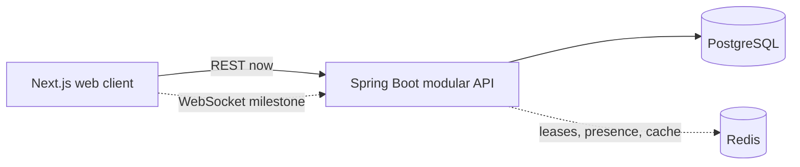

# TripMate 2.0

An individual rebuild of a collaborative trip-planning product, focused on preventing lost updates
while several people edit the same itinerary.

## Status

The foundation milestone includes:

- Next.js App Router frontend with TypeScript and a responsive product overview.
- Java 21 and Spring Boot 3.5 API.
- Trip and itinerary persistence with PostgreSQL-compatible Flyway migrations.
- Version fields on collaborative entities, ready for tested conflict handling.
- Request validation, consistent API errors, and integration tests.
- Docker Compose services for PostgreSQL and Redis.
- GitHub Actions checks for both applications.

Authentication, authorization, WebSockets, Redis edit leases, and two-client conflict recovery are
roadmap items—not completed claims.

## Origin and ownership

TripMate began as a five-person Seneca course project. This repository is Uny Li's individual redesign
and implementation. It does not copy the original team's source code, private data, or commit history.
The earlier project established the product idea; TripMate 2.0 rebuilds the architecture and critical
collaboration workflow from first principles.

## Architecture



The system starts as a modular monolith. Microservices, Kafka, and Kubernetes are intentionally out of
scope until the product has a measured need for them.

## Run locally

Requirements: Java 21+, Node.js 22 LTS+, and Docker Desktop.

```bash
cp .env.example .env
docker compose up -d postgres redis
```

Start the API:

```bash
cd apps/api
./mvnw spring-boot:run
```

Start the web app in another terminal:

```bash
cd apps/web
npm install
npm run dev
```

- Web: <http://localhost:3000>
- API health: <http://localhost:8080/actuator/health>

## Verify

```bash
make check
```

This runs Spring Boot integration tests, TypeScript checking, ESLint, and a production Next.js build.

## Current API

| Method | Path | Purpose |
| --- | --- | --- |
| `POST` | `/api/trips` | Create a trip |
| `GET` | `/api/trips/{tripId}` | Read a trip and itinerary |
| `POST` | `/api/trips/{tripId}/itinerary-items` | Add an itinerary item |

The API remains deliberately small while authorization and concurrency guarantees are built and
tested. Public deployment must wait until authentication and ownership rules are implemented.

## Roadmap

1. Spring Security authentication and owner/editor/viewer authorization.
2. Next.js trip dashboard and generated typed API client.
3. Optimistic update contract with `409 Conflict` recovery.
4. Redis-backed edit leases and collaborator presence.
5. WebSocket synchronization and reconnect reconciliation.
6. Cached geocoding and asynchronous AI itinerary suggestions.
7. Playwright two-browser tests, measured load tests, observability, and deployment.

See [ADR 0001](docs/adr/0001-modular-monolith.md) for the first architecture decision.
